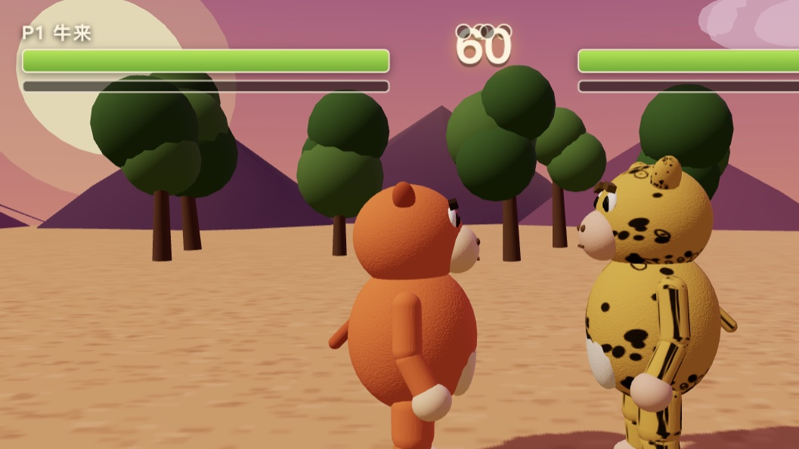
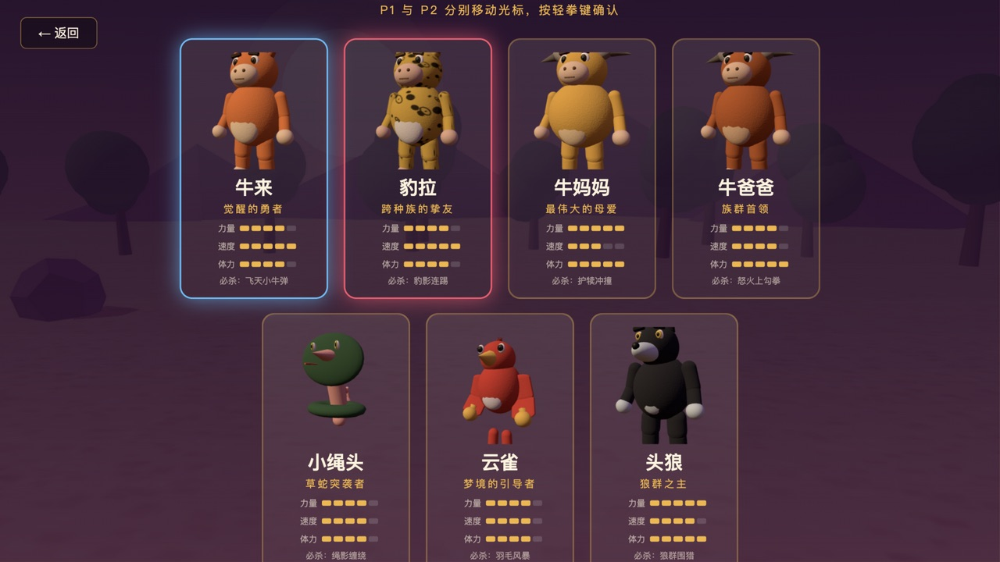
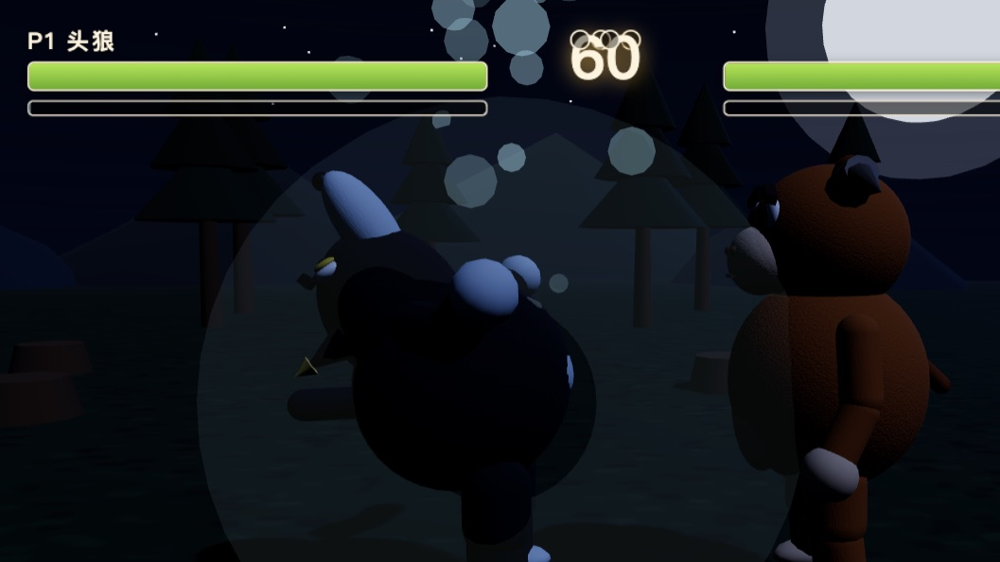
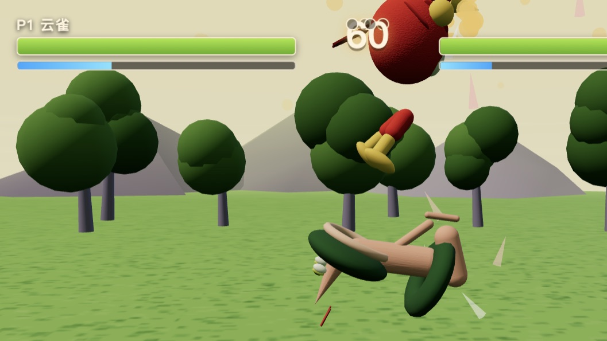
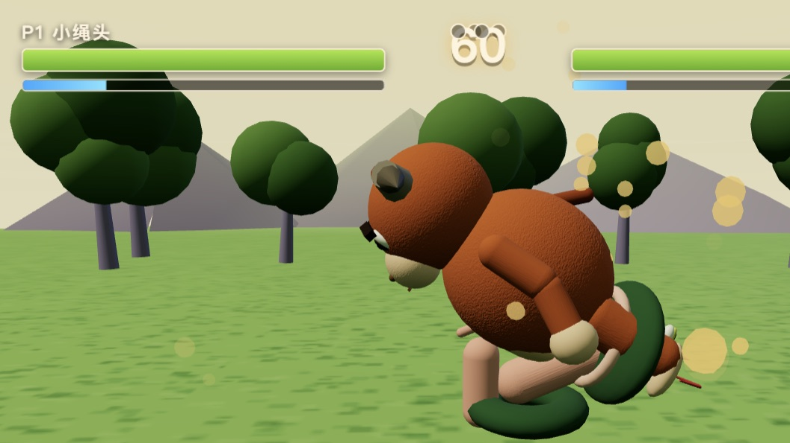
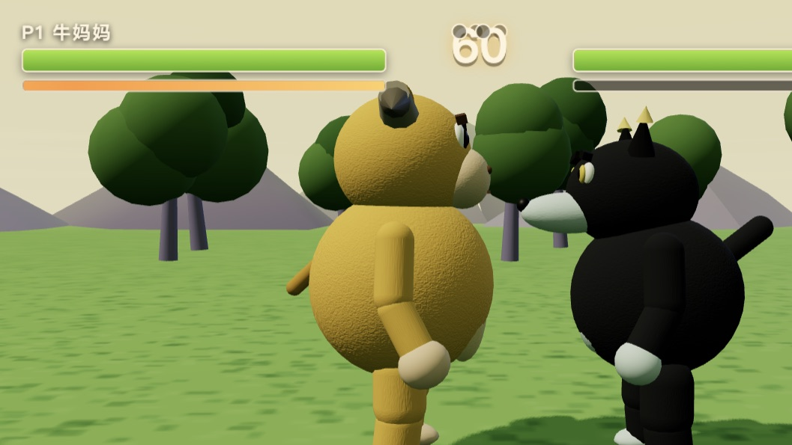
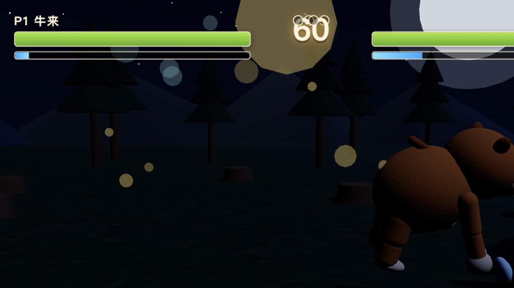

<div align="center">

# 🐂 牛来格斗 · NIU LAI FIGHT

**一款开源的 3D 双人格斗游戏** · 致敬《拳皇》《奥特曼格斗进化》，改编自 2026 年动画电影《牛来》

*A 3D two-player fighting game built with Three.js — local versus & LAN multiplayer, zero asset pipeline.*

[](LICENSE)
[](https://threejs.org)
[](#-快速开始)
[](#-角色阵容)
[](#-快速开始)



*牛来一记重踢把豹拉轰上天空——血条、能量条、连击提示一应俱全*

</div>

---

## ✨ 这是什么

一个**纯浏览器运行**的 3D 格斗游戏：无需安装、无需构建、没有任何图片/模型/音频资源文件——**所有角色、场景、特效、音效全部由代码程序化生成**。

本项目以经典格斗游戏（拳皇 / 街霸 / 奥特曼格斗进化）的帧数据方法论为设计基础，实现了完整的现代格斗游戏循环：**帧数据驱动招式、连招取消、打击停顿、能量必杀、三局两胜、KO 慢动作**，同时支持**同一台电脑双人对战**与**局域网联机对战**。

> 角色与世界取材自 2026 年由信雨萌、孙丽芳母子耗时五年制作的动画电影《牛来》——一头胆小的小牛在草原上成长为勇士的故事。本作为非商业粉丝致敬作品。

## 🎮 游戏内容

### 🥊 角色阵容（7 名）

每名角色有独立体型、招式数据和**专属必杀技**：

| 角色 | 定位 | 专属必杀技 |
|:---:|:---|:---|
| 🐂 **牛来** | 觉醒的勇者 · 最快步伐游击手 | **飞天小牛弹** —— 化身炮弹横向飞行撞击 |
| 🐆 **豹拉** | 跨种族的挚友 · 出手最快的连招手 | **豹影连踢** —— 近身乱舞多段吸附连击 |
| 🐄 **牛妈妈** | 最伟大的母爱 · 血厚攻高的守护重炮 | **护犊冲撞** —— 低身冲锋多段顶飞（带霸体） |
| 🐂 **牛爸爸** | 族群首领 · 均衡全能的重击手 | **怒火上勾拳** —— 前步升龙把对手打上天 |
| 🐍 **小绳头** | 草蛇突袭者 · 无肢盘绕的缠斗专家 | **绳影缠绕** —— 前扑锁敌原地连绞后甩飞 |
| 🐦 **云雀** | 梦境的引导者 · 空战压制型 | **羽毛风暴** —— 腾空追踪羽毛轰炸收尾俯冲 |
| 🐺 **头狼** | 狼群之主 · 嚎召幻狼的围猎指挥 | **狼群围猎** —— 仰天长啸召幻狼双侧掠袭 |



### 🌄 三大舞台（每局自动轮换）

| 舞台 | 氛围 | 代表演出 |
|:---:|:---|:---|
| 🌅 **落日荒漠** | 紫红岩山、圆球树、暖橙天空 | 招式的最佳秀场 |
| 🌙 **暗夜狼林** | 星空冷月、针叶剪影、散落树桩 | 狼群来袭之夜 |
| 🌿 **云雀之森** | 紫干圆冠树、光斑草地、暖黄天际 | 梦境般的绿意 |

### 🔥 必杀技演出

<p align="center">


</p>
<p align="center">


</p>
<p align="center"></p>

### 🕹️ 操作

| 动作 | 玩家 1 | 玩家 2 |
|:---|:---|:---|
| 移动 / 跳跃 | `A` `D` / `W` | `←` `→` / `↑` |
| 防御（按住） | `S` | `↓` |
| 轻拳 / 重拳 | `空格` / `左Shift` | `小键盘1`或`1` / `2` |
| 轻踢 / 重踢 | `E` / `Q` | `4` / `5` |
| **必杀技**（能量满） | `F` | `3` |
| 闪避（无敌帧） | 双击 `A`/`D` | 双击 `←`/`→` |

## 🚀 快速开始

```bash
git clone https://github.com/liyupi/niulai-game.git
cd niulai-game
npm install
npm start
```

打开 `http://localhost:3000` 即玩。

**局域网联机**：启动后控制台会打印局域网地址（如 `http://192.168.x.x:3000`），发给同一 Wi-Fi 下的朋友，双方都点「局域网联机对战」即可自动配对（先进入者为 P1 主机）。

<details>
<summary><b>🎮 完整游戏流程</b></summary>

标题界面（本地双人 / 人机练习 / 局域网联机）→ 角色选择（双人光标，人机模式还能给 AI 挑对手）→ 三局两胜制对战（60 秒限时、KO 慢动作推镜、K.O. / TIME UP 公告、连击弹幕）→ 胜负结算 → 再来一局。

</details>

## 🧠 格斗系统设计

参考拳皇 / 街霸的帧数据方法论实现，不是"能打中就掉血"的玩具：

- **帧数据驱动**：每招分「启动 → 判定 → 收招」三段。轻拳命中硬直长于收招时间差，可以自连成轻-轻连段；重招伤害高但破绽大——风险与回报并存
- **取消规则**：普通技命中后可取消衔接下一招，收招期可取消必杀技。标准连招路线：`轻拳 → 轻拳 → 重拳 → 必杀技`
- **打击感三件套**：命中瞬间全局冻结数帧（hitstop）+ 屏幕震动 + 变焦冲击；KO 触发慢动作推镜
- **连段伤害递减**：100% → 80% → 65% → 52% → 42% → 35%，杜绝无限连
- **能量系统**：命中回气多、挥空回气少、挨打也回气——落后方总有翻盘的必杀机会
- **防御与闪避**：按住防御格挡（削血 10%）；双击方向短距闪避并附带无敌帧
- **击倒与起身**：重踢和多数必杀造成腾空击倒，倒地无敌、起身短暂无敌

## 🛠️ 技术架构

对格斗游戏 / 实时同步感兴趣的开发者可能会喜欢的部分：

```
server.js        Node 静态服务 + WebSocket 房间配对中继（零数据库）
src/main.js      游戏状态机 + 固定步长主循环（120Hz 屏不掉帧、节流页不卡死）
src/fighter.js   斗士实体：18 态状态机 / 物理 / 招式执行 / 受击反应
src/model.js     程序化角色建模：关节层级 + 姿态插值动画 + 物种体形系统
src/moves.js     招式帧数据表（动画关键帧直接由帧数据生成）
src/combat.js    球-胶囊命中判定 / 连击统计 / 打击停顿
src/stage.js     三大舞台程序化生成（渐变天空穹顶 / 岩山 / 植被）
src/camera.js    格斗相机：自动取景 / 震动 / KO 推近
src/net.js       局域网联机：主机权威 + 30Hz 快照 + 客机插值渲染
src/audio.js     WebAudio 全合成音效（打击/格挡/KO锣声/必杀呼啸）
```

**亮点**：

- **零资源管线**：角色毛绒质感（凹凸贴图）、豹纹、场景贴图、所有音效均由 Canvas / WebAudio 运行时合成，仓库里没有一张游戏素材图
- **联机同步**：主机权威模拟 + 30Hz 状态快照下行 + 客机输入上行与插值渲染，打击特效/音效以事件流转发保证双端体验一致
- **性能工程**：动画采样与粒子系统全程零分配（无 GC 停顿）、场景资源严格 dispose（多局对战显存零增长）、着色器开局预编译消除首次出招卡顿
- **调试参数**：内置 AI 演示 / 招式展示 / 定格回放 / 自动化联机测试等 URL 钩子（见下表）

<details>
<summary><b>🔬 开发调试参数</b></summary>

| URL 参数 | 作用 |
|----------|------|
| `?fight=a,b&mode=ai` | 指定角色直接开局（id：xiaoniu/jinbao/dazhuang/zongniu/shetou/yunque/wolf） |
| `&stage=night\|forest\|sunset` | 固定舞台 |
| `&demo=showcase` / `&demo=ai` | 招式演示 / 双 AI 对打 |
| `&spOnly=1&full=1` | 循环演示必杀技 |
| `&freeze=秒` | 推进到指定时刻定格 |
| `&cycle=N` | 每 9 秒完整重建一局（资源释放压测） |
| `&select=1&mode=ai&autopick=我,AI` | 自动化选人流程测试 |

</details>

## 🗺️ Roadmap

- [ ] 更多角色（云雀妈妈？狼群双打？）
- [ ] 必杀技 CG 演出与回放系统
- [ ] 在线房间码联机（穿透公网）
- [ ] 移动端触屏适配
- [ ] 训练模式（帧数据显示 / 录像回放）

## 🤝 参与贡献

欢迎 Issue 与 PR：新增角色（`src/characters.js` 加定义即可获得完整建模）、新舞台、新必杀机制、平衡性调整、联机优化都是好方向。

## ⚖️ 版权说明

- 本项目代码以 [MIT](LICENSE) 协议开源
- 游戏角色与世界观取材自动画电影《牛来》（导演：信雨萌），相关版权归原出品方所有；本项目为**非商业粉丝致敬作品**，如有侵权请联系删除
- 《拳皇》《街头霸王》《奥特曼格斗进化》为 SNK / CAPCOM / 万代南梦宫之商标，本项目仅为玩法致敬，无任何关联

<div align="center">

**如果这个项目对你有帮助，欢迎点一个 ⭐ Star**

牛来都站起来了，你也可以。

</div>
